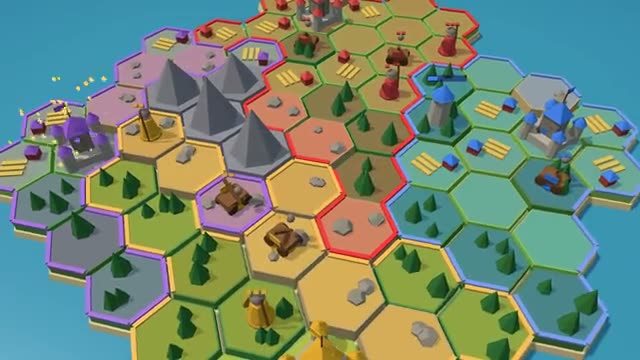

# Hex Empires

Claim the island. Build, march, take their castles. A multiplayer starter game from [Multiplayer Agent](https://multiplayeragent.com): 3D, turn-based, 2–4 players plus anyone who wants to watch, with bots that rule every empty empire.

## How it plays

A mini 4X on a seeded hex island, about 15 minutes a match. Each turn your land makes food, wood and stone. Spend it to claim hexes, build farms and towers, and train soldiers and catapults. Soldiers take enemy land they stand on; catapults knock down towers and castles from two hexes away. Take every rival castle, or have the biggest empire after 16 rounds. Bots rule the empty empires, and a friend who joins takes one over mid-match.

**Controls:** Click or tap a hex: gold hexes claim land, your castle trains units, your units walk (blue) and attack (red). End turn when you're done.

## Make it yours in the Game Builder

Open the [Game Builder](https://multiplayeragent.com), choose **Start from a starter game** and pick Hex Empires. It opens as version 1 in your studio, ready to play and publish. Then ask for changes, for example:

- Add a market that trades wood for stone
- Add knights that move three hexes
- Make the island bigger with a lake in the middle

## Run it yourself

1. Get a free publishable key (`pk_…`) at [multiplayeragent.com](https://multiplayeragent.com).
2. In `index.html`, put it in place of `pk_REPLACE_ME` in the `MP_CONNECT` block.
3. Serve the folder (for example `npx serve`) and open it. The 3D engine loads as a module, which browsers block from a file on disk.

Without a key it still runs, offline against the bots.

## How it is built

- One `index.html`, plus three.js in `libs/`. The comment at the top of the script maps the code and explains the multiplayer.
- **Host-run rules:** The host's browser checks every action and plays the bot empires; if it leaves, the next player takes over.
- **Bots:** Bots rule every empty empire, so you can play alone, and a friend who joins takes over a bot's empire mid-match.
- **Live sync:** Everyone sees the same seeded island, armies and borders; the match carries on if someone reloads while another player stays.
- **Leaderboard:** Most wins, shown after every match.
- `?attract` runs it offline, four bots a few rounds in. The preview video is recorded from it.

## License

MIT.
